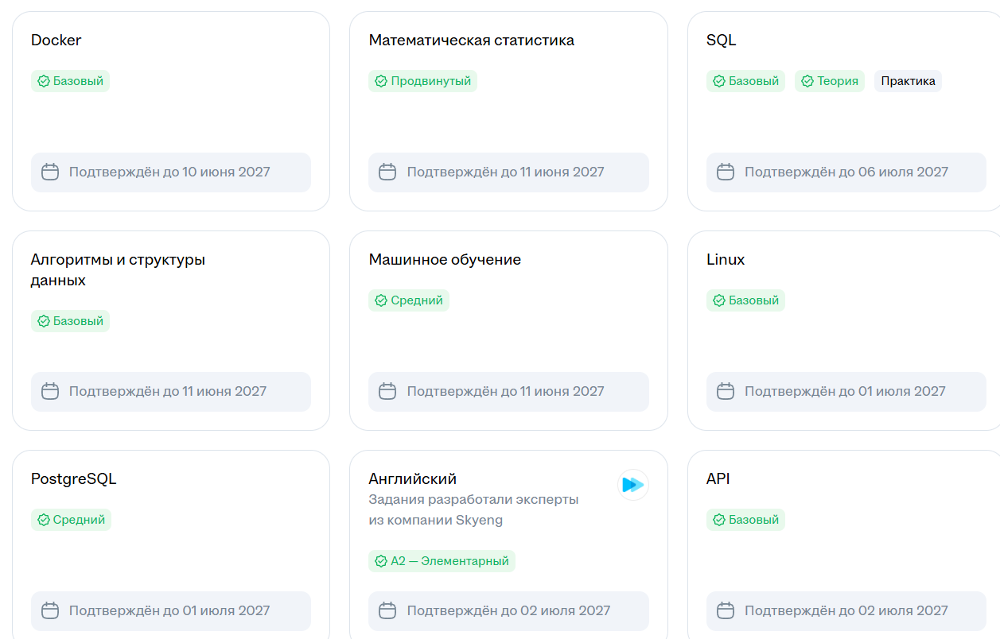
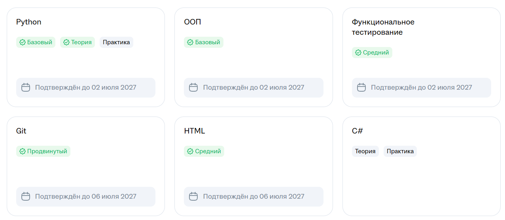

# Оценка капитализации компаний — AAI_25_Case84Report

Учебный ML-проект: регрессия `Market Cap` компаний S&P 500 по табличным финансовым
показателям. Исследовательские ноутбуки сохранены как архив экспериментов. Рабочая логика
вынесена в устанавливаемый пакет `company_capitalization` с CLI `capitalization train/predict`,
тестами, линтерами, pre-commit, CI и воспроизводимым окружением Poetry.

## Задание и результат

| № | Задача | Статус |
| --- | --- | --- |
| 1 | Сдать на hh.ru тесты: Машинное обучение; Python. Теория и практика; SQL. Теория и практика; Docker, Git, Linux, ООП | Сданы все |
| 2 | Рефакторинг кода ML-проекта под production-стандарты | Выполнено: пакет, CLI, исправленная ML-логика, 44 теста |
| 3 | Настройка pre-commit, Poetry, линтеров | Выполнено: Poetry 2.5.1 + lock, Ruff, mypy strict, pre-commit, GitHub Actions |
| 4 | Интеграция виртуального окружения в Git-репозиторий ML-проекта | Выполнено: `.venv` в проекте, конфигурация и `poetry.lock` в Git, `.venv` в `.gitignore` |

---

## 1. Тесты на hh.ru

Сверх задания сданы: Математическая статистика (Продвинутый), PostgreSQL (Средний),
Алгоритмы и структуры данных (Базовый), API (Базовый), Функциональное тестирование
(Средний), HTML (Средний), Английский (A2).





---

## 2. Рефакторинг кода под production-стандарты

### Что было

Девять ноутбуков с дублирующимся кодом, `%pip install` без фиксации версий, глобальное
состояние, разные train/test соотношения и несколько ошибок ML-логики (ниже).

### Что сделано

| Модуль | Ответственность |
| --- | --- |
| [data.py](src/company_capitalization/data.py) | Чтение CSV, проверка схемы (`SchemaError`), NaN/inf, правила отбора строк, SHA-256 данных |
| [features.py](src/company_capitalization/features.py) | Детерминированные признаки только из входов; `FeatureBuilder` для Pipeline |
| [models.py](src/company_capitalization/models.py) | Реестр 10 моделей; `TransformedTargetRegressor(log1p/expm1)` + Pipeline/ColumnTransformer |
| [evaluation.py](src/company_capitalization/evaluation.py) | RMSE/MAE/R²/MAPE в USD и отдельно метрики `*_log1p` |
| [training.py](src/company_capitalization/training.py) | Train/holdout split, KFold CV на train, обучение, артефакты и метаданные |
| [tuning.py](src/company_capitalization/tuning.py) | Необязательный Optuna-подбор на CV по train с бюджетом |
| [prediction.py](src/company_capitalization/prediction.py) | Загрузка артефакта и прогноз для CSV без `Market Cap` |
| [cli.py](src/company_capitalization/cli.py) | Команда `capitalization`: `train`, `predict`, `models` |
| [tests/](tests/) | 44 быстрых теста на синтетических данных |
| [notebooks/demo_package_usage.ipynb](notebooks/demo_package_usage.ipynb) | Демо-ноутбук, вызывающий пакет вместо копирования кода |

Принципы: модели не обучаются при импорте, пути через `pathlib`, `logging` вместо `print`,
аннотации типов (mypy strict) и docstring. Ошибки пользователя CLI выводит понятным
сообщением с кодом выхода 2.

Модели: `dummy`, `ridge` (baseline), `linear`, `decision_tree`, `random_forest`, `svr`,
`stacking`, а при установленном extra `boosting` ещё `xgboost`, `lightgbm` и `catboost`
(с нативной категорией Sector). Если пакета нет, команда подсказывает, как его установить.

### Исправления ML-логики

1. **Утечка цели.** Основной ноутбук считал `Earnings = Market Cap / (P/E)` (и так же
   Sales и Book) и подавал их логарифмы в X, то есть модель получала ответ. Теперь
   признаки строятся только из 10 входных колонок. Тесты проверяют, что изменение
   или удаление цели не меняет X.
2. **Разные формулы Earnings/Sales/Book.** В `financials.csv` все 505 строк равны
   `Price / ratio` (величина на акцию), а не `Market Cap / ratio`. Эти колонки исключены.
   Вместо них введены признаки с явной формулой: `1/(P/E)`, `1/(P/S)`, `1/(P/B)`.
3. **`52 Week Low > 52 Week High` во всех 505 строках.** CSV не исправлялся. Границы
   берутся через `min/max`, расхождение помечается флагом, относительный диапазон всегда
   неотрицательный. Это диапазон цены, а не волатильность.
4. **Предобработка до CV** (RobustScaler в основном ноутбуке, scaler в XGBoost). Теперь
   imputer, scaler и encoder обучаются внутри Pipeline на каждом fold; это проверено тестом.
5. **Test как `eval_set` CatBoost.** Теперь есть отдельный holdout. CV и Optuna работают
   только на train, CatBoost обучается без early stopping по holdout.
6. **Стекинг.** У каждого базового estimator своя предобработка, поэтому OOF-прогнозы
   не видят статистик чужого fold.
7. **Смешение `log`/`exp`, `log1p`/`expm1`, `log1p(abs(y))`.** Теперь везде одна пара
   `log1p`/`expm1` через `TransformedTargetRegressor`, и predict возвращает USD.
8. **`EBITDA = 0` у 58 компаний** (51 из них Financials). Ноль трактуется как «не раскрыто»:
   ставится флаг, знак хранится отдельно, `log(|x|)` не используется. С этим изменением
   R² log1p у Ridge в CV вырос с 0.22 до 0.76.
9. **NaN/inf, неизвестный Sector, отсутствующие колонки** обрабатываются. Строки
   с отсутствующей или неположительной целью исключаются, их число пишется в метаданные
   (на реальных данных исключено 0 из 505).
10. **Seed** задаётся в разбиении, CV, моделях и Optuna.

### Метрики на реальных данных

`financials_src.csv`: 505 строк, seed 42, holdout 101 строка, KFold 5 на 404 строках,
гиперпараметры по умолчанию. RMSE и MAE даны в млрд USD.

| Модель | CV R² log1p | Holdout RMSE | Holdout MAE | Holdout R² | Holdout MAPE | Holdout R² log1p | Время |
|---|---:|---:|---:|---:|---:|---:|---:|
| dummy | -0.009 | 107.1 | 40.8 | -0.046 | 1.185 | -0.032 | 2 с |
| ridge | 0.760 | 38.2 | 15.5 | 0.867 | 0.454 | 0.689 | 2 с |
| linear | 0.757 | 37.7 | 15.4 | 0.870 | 0.455 | 0.687 | 2 с |
| decision_tree | 0.617 | 75.8 | 26.6 | 0.476 | 0.565 | 0.592 | 1 с |
| random_forest | 0.754 | 70.4 | 21.8 | 0.548 | 0.410 | 0.706 | 5 с |
| svr | 0.707 | 78.6 | 25.1 | 0.437 | 0.429 | 0.668 | 2 с |
| xgboost | 0.787 | 62.9 | 19.8 | 0.639 | 0.406 | 0.714 | 3 с |
| lightgbm | 0.766 | 60.3 | 18.4 | 0.668 | 0.364 | 0.747 | 2 с |
| catboost | 0.792 | 61.8 | 19.2 | 0.651 | 0.396 | 0.718 | 86 с |
| stacking | 0.795 | 54.4 | 18.0 | 0.730 | 0.380 | 0.731 | 26 с |

В log-шкале лучшие модели — stacking, catboost и xgboost; в долларах лучше линейные.
Holdout маленький, поэтому разница между сильными моделями в пределах шума. Метрики
старых ноутбуков получены с утечкой цели, сравнивать с ними нельзя.

---

## 3. Poetry, pre-commit, линтеры

- **Poetry 2.5.1.** [pyproject.toml](pyproject.toml) (PEP 621, src-layout, entry point
  `capitalization`):
  - runtime: numpy, pandas, scikit-learn, joblib;
  - extras: `boosting` (xgboost, lightgbm, catboost) и `tuning` (optuna);
  - группа `dev`: ruff, mypy, pytest, pre-commit, pandas-stubs;
  - optional-группа `notebook`.

  [poetry.lock](poetry.lock) сгенерирован командой `poetry lock`.
- **Ruff** заменяет flake8, isort и black (lint + format). Правила
  `E,W,F,I,B,UP,SIM,N,C4,PTH,NPY,PD,RUF,D`.
- **mypy** в режиме `strict` для пакета.
- **[.pre-commit-config.yaml](.pre-commit-config.yaml)**:
  - ruff-check `--fix` и ruff-format (v0.16.10, та же версия, что в lock);
  - проверки YAML/TOML/JSON, merge-conflict, концов файлов и пробелов, LF;
  - поиск приватных ключей и лимит размера файлов 1 МБ.

  Архивные ноутбуки и исходные CSV исключены из форматирования.
- **[GitHub Actions](.github/workflows/ci.yml)**: lock → install → ruff → format-check →
  mypy → pytest → pre-commit → smoke train/predict → build. Матрица Ubuntu/Windows
  × Python 3.12/3.14.

Результаты локальных проверок (Windows 11, Python 3.14.7):

| Команда | Результат |
| --- | --- |
| `poetry check --lock` | All set |
| `poetry install --with dev` | ок |
| `poetry run ruff check src tests` | All checks passed |
| `poetry run ruff format --check src tests` | 14 files already formatted |
| `poetry run mypy src/company_capitalization` | no issues found in 9 source files |
| `poetry run pytest` | 44 passed |
| `poetry run pre-commit run --all-files` | все hooks Passed |
| `poetry build` | sdist + wheel собраны |
| Чистая установка без extras | 40 passed, 4 skipped; baseline train/predict работает |

---

## 4. Виртуальное окружение и Git

- [poetry.toml](poetry.toml) задаёт `virtualenvs.in-project = true`, поэтому окружение
  создаётся в `.venv/` в корне проекта.
- В Git хранятся `pyproject.toml`, `poetry.lock`, `poetry.toml` и инструкции. Сама `.venv/`
  в [.gitignore](.gitignore). То же касается локального Poetry (`.tools/`), кэшей
  и артефактов моделей.
- **Почему `.venv` не коммитится.** В ней интерпретатор и бинарные пакеты под конкретную
  ОС и версию Python, абсолютные пути и сотни мегабайт данных. На другой машине она
  не работает. Воспроизводимость обеспечивает `poetry.lock`: он фиксирует точные версии
  и хеши пакетов, а `poetry install` восстанавливает окружение.
- [.gitattributes](.gitattributes) нормализует концы строк (LF) и хранит архивные
  CSV и ноутбуки побайтово.
- Проверено через `git check-ignore`: `.venv`, кэши и артефакты игнорируются, а данные,
  ноутбуки и конфигурация — нет.

### Установка после clone

Poetry можно поставить локально в проект, не трогая систему.

Windows (PowerShell):

```powershell
python -m venv .tools\poetry
.tools\poetry\Scripts\python -m pip install poetry==2.5.1
Set-Alias poetry "$PWD\.tools\poetry\Scripts\poetry.exe"
```

Linux/macOS:

```bash
python3 -m venv .tools/poetry
.tools/poetry/bin/python -m pip install poetry==2.5.1
alias poetry="$PWD/.tools/poetry/bin/poetry"
```

Дальше команды одинаковые для всех ОС:

```bash
poetry check --lock
poetry install --with dev --all-extras   # .venv из poetry.lock
poetry run pre-commit install            # git-hook
```

Для одного baseline достаточно `poetry install`. Python: `>=3.12,<3.15`.

---

## Запуск

```bash
poetry run capitalization models
poetry run capitalization train --data financials_src.csv --model ridge \
    --seed 42 --test-size 0.2 --cv-folds 5 --output-dir artifacts/ridge
poetry run capitalization predict --model artifacts/ridge \
    --data examples/companies_without_target.csv \
    --output artifacts/predictions/ridge_predictions.csv
```

Параметры `train`:

| Флаг | По умолчанию | Назначение |
| --- | --- | --- |
| `--data` | `financials_src.csv` | Размеченный CSV |
| `--model` | `ridge` | Модель из реестра |
| `--seed` | `42` | Seed для split, CV, моделей, Optuna |
| `--test-size` | `0.2` | Доля holdout |
| `--cv-folds` | `5` | KFold на train |
| `--output-dir` | `artifacts/<model>` | Каталог артефактов |
| `--n-jobs` | `1` | Потоки модели |
| `--param KEY=VALUE` | — | Переопределить гиперпараметр |
| `--tune-trials`, `--tune-timeout` | `0` | Явный Optuna-подбор с бюджетом (extra `tuning`) |

Артефакты: `model.joblib` (весь Pipeline с обратным преобразованием цели),
`metrics.json`, `metadata.json` (seed, параметры, версии, схема входа, SHA-256 данных,
индексы train/holdout) и `holdout_predictions.csv`. `model.joblib` — это pickle,
загружайте только доверенные файлы.

## Данные

| Файл | Описание |
| --- | --- |
| [financials_src.csv](financials_src.csv) | Исходные данные, 505 × 14 (используются по умолчанию) |
| [financials.csv](financials.csv) | Обработанные данные, 505 × 17 (пропуски заполнены на всём наборе до разбиения) |
| [examples/companies_without_target.csv](examples/companies_without_target.csv) | 20 строк без `Market Cap` для проверки predict |

Цель — `Market Cap` (USD). Входы модели: `Sector, Price, Price/Earnings, Dividend Yield,
Earnings/Share, 52 Week Low, 52 Week High, EBITDA, Price/Sales, Price/Book`. Дата данных
по ноутбуку — июль 2020 года, но она не подтверждена; это не текущие котировки.

## Архив экспериментов

[CompanyCapitalizationEvalution.ipynb](CompanyCapitalizationEvalution.ipynb) и
[Stages_Notebooks/](Stages_Notebooks/) (EDA/LinearRegression, DecisionTree, RandomForest,
SVR, XGBoost, CatBoost, LightGBM, Stacking) сохранены без изменений как история
исследования. Ошибки в них описаны выше в разделе «Исправления ML-логики».
